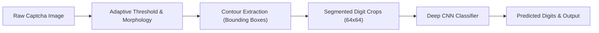

# Captcha Digit Segmentation & Recognition with CNN

> 🎓 **Academic Note:** This project was developed as an advanced practical assignment for the **Machine Learning & Deep Learning Course** to explore image segmentation, morphological filtering, and deep convolutional neural networks (CNNs).

---

## 📌 Project Overview

CAPTCHA codes present a classic challenge in computer vision due to salt-and-pepper background noise, variable digit strokes, and spatial distortion. This project implements a robust, end-to-end two-stage solution:

1. **Segmentation & Contour Extraction:**
   - Denoising with median filtering (`cv2.medianBlur`) to suppress isolated salt noise.
   - Adaptive binarization (`cv2.adaptiveThreshold`) to separate digit strokes from background textures.
   - Morphological opening (`cv2.morphologyEx` with a $2 \times 2$ kernel) to prune peripheral specks.
   - External contour detection (`cv2.findContours` and `cv2.boundingRect`) sorting extracted digit segments horizontally from left to right.

2. **Classification with Regularized CNN:**
   - A 4-stage convolutional neural network architecture with 32, 64, 128, and 256 feature channels.
   - Training stabilization via **Batch Normalization** and $L_2$ kernel regularization.
   - Intermediate **Dropout layers (0.2 to 0.4)** mitigating memorization of specific noise patterns.
   - Real-time data augmentation (`rotation_range`, `width_shift`, `zoom`) using `ImageDataGenerator`.
   - Adaptive learning rate decay with `ReduceLROnPlateau` and early stopping on validation loss.

---

## 🏗️ Architecture & Pipeline Flow



---

## 📂 Project Structure

```text
captcha-digit-recognizer-cnn/
│
├── digit_extraction.py     # End-to-end solver: segments contours, predicts digits, saves annotated output
├── training_captcha.py     # Deep CNN training pipeline with augmentation and regularization
├── CAptcha.jpg             # Sample captcha image for pipeline validation
├── requirements.txt        # Project dependencies (OpenCV, TensorFlow, etc.)
├── .gitignore              # Files excluded from version control
└── README.md               # Project documentation
```

---

## ⚙️ Installation & Usage

### 1. Clone the repository
```bash
git clone https://github.com/RahaVefghi/captcha-digit-recognizer-cnn.git
cd captcha-digit-recognizer-cnn
```

### 2. Install dependencies
```bash
pip install -r requirements.txt
```

### 3. Run the end-to-end captcha solver
Execute the inference pipeline to segment digits from `CAptcha.jpg`, classify each digit, and save the annotated visualization to `captcha_result.png`:
```bash
python digit_extraction.py
```

### 4. Train the CNN model
```bash
python training_captcha.py
```

---

## 🛠️ Technologies Used
- **Python 3.10+**
- **OpenCV (cv2):** Morphological filters, adaptive thresholding, contour extraction
- **TensorFlow / Keras:** Deep Convolutional Neural Network architecture
- **Scikit-Learn:** Label encoding, class weighting, stratified data splitting
- **Matplotlib:** Training curve visualization
