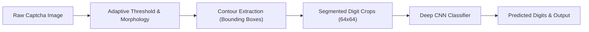

# Captcha Digit Segmentation & Recognition with CNN
### سیستم تفکیک و تشخیص ارقام کدهای کپچا با بینایی ماشین و یادگیری عمیق

> 🎓 **Academic Note:** This project was developed as an advanced practical assignment for the **Machine Learning & Deep Learning Course** to explore image segmentation, morphological filtering, and deep convolutional neural networks (CNNs).

---

## 📌 Project Overview (معرفی پروژه)

کدهای کپچا (CAPTCHA) به عنوان یکی از چالش‌های کلاسیک بینایی ماشین شناخته می‌شوند زیرا شامل نویزهای نقطه‌ای، تغییر شکل ارقام و پس‌زمینه‌های نامنظم هستند. این پروژه یک پایپ‌لاین کامل (End-to-End) شامل دو مرحله‌ی اساسی است:

1. **بخش‌بندی و کانتوریابی (Segmentation & Contour Extraction):**
   - پیش‌پردازش تصویر با فیلتر میانه (`cv2.medianBlur`) جهت حذف نویزهای تک‌نقطه‌ای.
   - آستانه‌گیری تطبیقی (`cv2.adaptiveThreshold`) جهت تفکیک رقم از پس‌زمینه.
   - اعمال عملگرهای ریخت‌شناسی (`cv2.morphologyEx` با Kernel 2x2) جهت پالایش نویزهای حاشیه‌ای.
   - استخراج مختصات کادر احاطه‌کننده هر رقم با الگوریتم کانتوریابی (`cv2.findContours` و `cv2.boundingRect`).

2. **طبقه‌بندی و شناسایی رقم با شبکه کانوولوشنی (CNN Classification):**
   - طراحی معماری ۴ بلوکه CNN با ۳۲، ۶۴، ۱۲۸ و ۲۵۶ فیلتر.
   - پایدارسازی آموزش با لایه‌های **Batch Normalization** و منظم‌سازی **L2 Regularization**.
   - جلوگیری از بیش‌برازش (Overfitting) با لایه‌های **Dropout (0.5)** و **Global Average Pooling**.
   - افزایش داده‌ها (**Data Augmentation**) با چرخش، جابجایی و برش تصویر (`ImageDataGenerator`).
   - تنظیم پویای نرخ یادگیری با کال‌بک‌های `ReduceLROnPlateau` و `EarlyStopping`.

---

## 🏗️ Architecture & Pipeline (پایپ‌لاین پردازش)



---

## 📂 Project Structure (ساختار فایل‌ها)

```text
captcha-digit-recognizer-cnn/
│
├── digit_extraction.py     # اسکریپت استخراج کانتورها و باکس‌بندی ارقام
├── training_captcha.py     # اسکریپت ساخت و آموزش مدل CNN روی تصاویر ارقام
├── CAptcha.jpg             # تصویر نمونه برای ارزیابی پایپ‌لاین
├── requirements.txt        # کتابخانه‌های لازم (OpenCV, TensorFlow, etc.)
├── .gitignore              # فایل‌های نادیده گرفته‌شده توسط گیت
└── README.md               # مستندات پروژه
```

---

## ⚙️ Installation & Usage (نحوه نصب و اجرا)

### ۱. نصب پیش‌نیازها
```bash
pip install -r requirements.txt
```

### ۲. تست استخراج کانتور ارقام کپچا
برای مشاهده نحوه کادرگیری ارقام روی تصویر کپچا دستور زیر را اجرا کنید:
```bash
python digit_extraction.py
```

### ۳. آموزش شبکه عصبی CNN
```bash
python training_captcha.py
```
*(مدل به صورت خودکار با ارزیابی روی داده‌های ولیدیشن و اعمال ذخیره‌سازی بهترین وزن‌ها در `digit_best.keras` آموزش می‌بیند.)*

---

## 🛠️ Technologies Used (فناوری‌های به‌کار رفته)
- **Python 3.10+**
- **OpenCV (cv2):** Image Preprocessing & Contours
- **TensorFlow / Keras:** Deep Convolutional Neural Network
- **Scikit-Learn:** Metric Evaluation & Data Splitting
- **Matplotlib:** Training Curves & Visualizations
